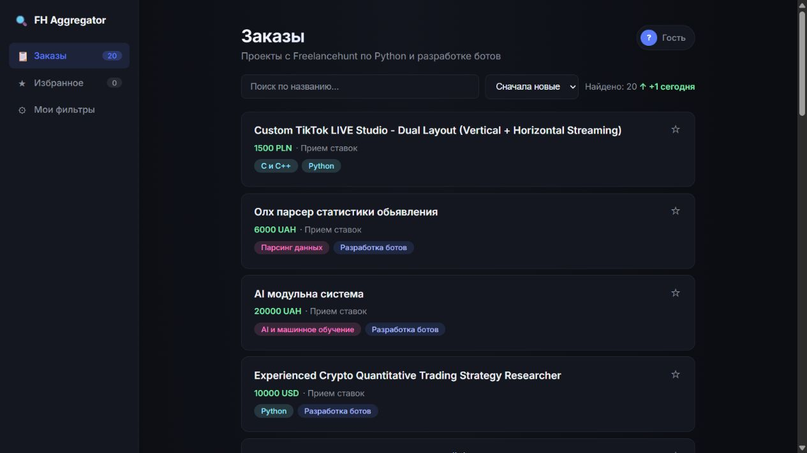

# Freelance Job Aggregator

Сервис собирает проекты с Freelancehunt, сохраняет их в PostgreSQL и помогает находить подходящие заказы. В React-панели можно просматривать проекты и управлять фильтрами; backend сопоставляет новые заказы с сохранёнными условиями и отправляет уведомления в Telegram.

**[Открыть демо](https://aggregator-wk8a.vercel.app/)**



**Python · FastAPI · PostgreSQL · SQLAlchemy · Alembic · React · Docker · pytest**

## Возможности

- Получение проектов через Freelancehunt API с фильтрацией по навыкам.
- Обновление проектов без дублирования по ID источника.
- API списка заказов, фильтрации по навыку и постраничной выдачи.
- Сохранённые пользовательские фильтры по ключевому слову и минимальному бюджету.
- Сопоставление новых проектов с фильтрами и Telegram-уведомления.
- React-панель со списком заказов, избранным и настройками фильтров.
- Миграции базы, Docker Compose, автоматические проверки в GitHub Actions.

## Архитектура

```text
Freelancehunt API → синхронизация → PostgreSQL → FastAPI → React
                         ↓
                фильтры → Telegram
```

## Быстрый старт с Docker

```bash
git clone https://github.com/Pybackendev/aggregator.git
cd aggregator
```

Скопируйте `.env.example` в `.env`. Заполните `FREELANCEHUNT_TOKEN`; для уведомлений — `TELEGRAM_BOT_TOKEN` и `TELEGRAM_CHAT_ID`.

```bash
docker compose up --build
```

Compose запускает PostgreSQL 16, API и планировщик. Контейнер API применяет существующие миграции перед запуском. База хранится в volume `db_data`; подключение к локальной БД внутри контейнеров задаётся в Compose.

API-документация: http://localhost:8000/docs. Остановка: `docker compose down`.

## Frontend

```bash
cd frontend
npm install
```

Скопируйте `.env.example` в `.env`, задайте `VITE_API_URL=http://localhost:8000`.

```bash
npm run dev
```

Панель: http://localhost:5173. Сборка: `npm run build`.

## Локальный backend без Docker

Нужны Python 3.11+, Poetry и PostgreSQL.

```bash
poetry install
```

Заполните `.env`, указав строку подключения `DATABASE_URL`.

```bash
poetry run alembic upgrade head
poetry run uvicorn app.main:app --reload
```

В другом терминале:

```bash
poetry run python -m parser.scheduler
```

Создавать новую начальную миграцию для запуска не нужно: существующие миграции находятся в `alembic/versions/`.

## Настройки

| Переменная | Назначение |
| --- | --- |
| `DATABASE_URL` | Подключение PostgreSQL с драйвером asyncpg |
| `FREELANCEHUNT_TOKEN` | Токен Freelancehunt API |
| `FREELANCEHUNT_SKILL_IDS` | ID навыков; по умолчанию `22,180` |
| `TELEGRAM_BOT_TOKEN` | Токен бота уведомлений |
| `TELEGRAM_CHAT_ID` | Чат общих уведомлений |
| `SYNC_INTERVAL_MINUTES` | Интервал планировщика; по умолчанию `15` |
| `SYNC_TRIGGER_TOKEN` | Секрет для внешнего запуска синхронизации |
| `VITE_API_URL` | Адрес backend; задаётся отдельно во frontend |

Альтернативный запуск синхронизации: `POST /internal/sync` с заголовком `X-Sync-Token`. Workflow `.github/workflows/sync.yml` использует секреты GitHub `RENDER_API_URL` и `SYNC_TRIGGER_TOKEN`. Внешний триггер можно использовать вместо постоянно работающего планировщика.

## Проверки

```bash
poetry run pytest
```

Тесты охватывают API-клиент, сохранение проектов и сопоставление фильтров. Проверка живой интеграции выполняется отдельно: нужны действующий токен источника, запущенный backend и проверка полученных заказов и уведомлений. Для публичной панели также требуется доступный backend и корректная настройка CORS.

## Структура

```text
app/api/          # HTTP-маршруты
app/core/         # настройки и БД
app/models/       # SQLAlchemy-модели
app/schemas/      # схемы API
app/services/     # сопоставление фильтров
parser/           # API-клиент, sync, уведомления, планировщик
frontend/         # React + Vite
alembic/          # миграции
tests/            # автоматические проверки
.github/workflows/# CI и запуск синхронизации
```

## Автор

[Pybackendev](https://github.com/Pybackendev) · [Связаться на Freelancehunt](https://freelancehunt.com/freelancer/Pybackendev.html)


